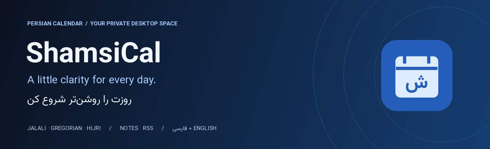
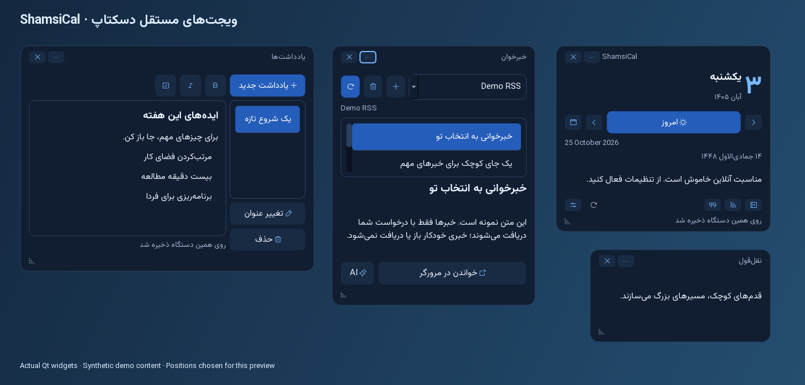
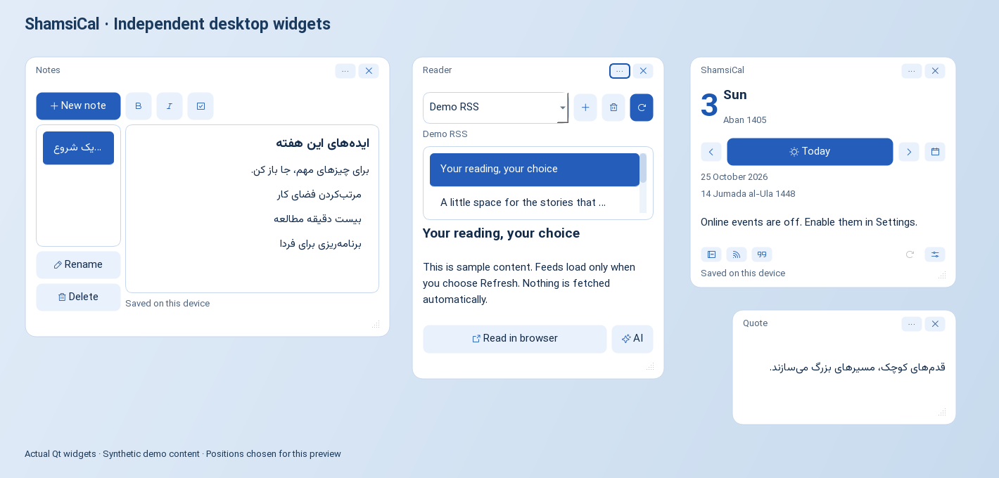
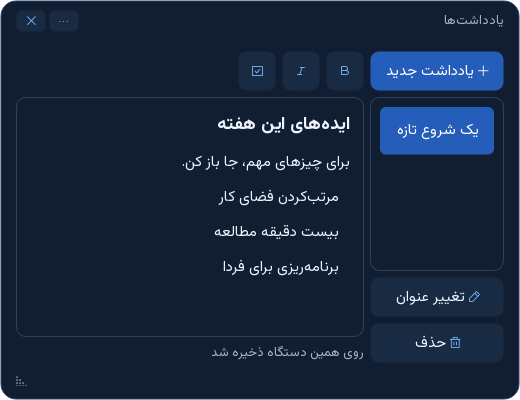

<p align="center"></p>

<p align="center">
  <a href="https://github.com/maboox/ShamsiCal/releases/latest"></a>
  <a href="README.fa.md"></a>
  <a href="docs/USER_GUIDE.md"></a>
</p>
<p align="center">
  <a href="https://github.com/maboox/ShamsiCal/actions/workflows/ci.yml"></a>
  <a href="https://github.com/maboox/ShamsiCal/releases"></a>
  <a href="LICENSE"></a>
  
</p>

ShamsiCal is a set of lightweight, independent Persian desktop widgets: a daily calendar, quotes, notes, and an RSS reader. Each widget floats on your desktop without a normal window frame, can be dragged and resized separately, and remembers its own position and visibility. Jalali dates come first; Gregorian and Umm al-Qura Hijri dates stay close by. Your calendar and notes work without an account or internet connection.

<div dir="rtl">

**شمسی‌کَل** مجموعه‌ای از ویجت‌های مستقل تقویم، نقل‌قول، یادداشت و خبرخوان روی دسکتاپ است؛ هر ویجت جدا جابه‌جا و پنهان می‌شود و جای خود را به خاطر می‌سپارد. تقویم و یادداشت بدون اینترنت کار می‌کنند؛ ارتباط آنلاین اختیاری است. [راهنمای کامل فارسی ←](README.fa.md)

</div>



### A small space for your day

| Calendar | Notes | Reading |
| --- | --- | --- |
| Small daily widget + optional month widget | Rich text and multiple notes | Add your own HTTPS RSS/Atom feeds |
| Gregorian dates in every day cell | Bold, italic, and checklists | Fetch on demand without blocking the UI |
| Day/month navigation and date jump | Local autosave and previous-save backup | Read sanitized excerpts or open the original |
| Midnight rollover and compact view | Export, restore, and import v1 notes | Optional Persian AI summaries after confirmation |

- **Desktop widgets first.** Calendar and quotes appear by default; notes and RSS are optional. Drag a widget by its header, resize from its corner, and use its menu or the tray icon to show/hide widgets. Settings also offers transparent backgrounds, opacity, and optional always-on-top behavior.
- **Made for both directions.** Persian RTL and English LTR, ocean and daylight blue themes, adjustable text, bundled Vazirmatn typography, and Phosphor icons through QtAwesome.
- **Private by default.** No telemetry, ads, login, or automatic feed fetching. Online events are off until enabled. Notes are stored locally **without encryption**; protect your device and exported backups.
- **Safer network behavior.** Verified HTTPS, public-address checks for each redirect, DNS-rebinding protection, response-size limits, and text-only news display. [Privacy details](docs/PRIVACY.md).

### Get started

**Windows 10/11, 64-bit:** download `ShamsiCal-2.1.0-windows-x64.zip` from [Releases](https://github.com/maboox/ShamsiCal/releases/latest), extract the entire archive, and open `ShamsiCal/ShamsiCal.exe`. Keep the `_internal` folder beside it. Python is not required. The executable is unsigned; verify its SHA-256 against the supplied checksum before opening it.

**From source** — Python 3.11+, in a fresh virtual environment:

```console
git clone https://github.com/maboox/ShamsiCal.git
cd ShamsiCal
python -m venv .venv
# Windows: .venv\Scripts\activate
# Linux/macOS: source .venv/bin/activate
python -m pip install --require-hashes -r requirements.lock
python -m pip install --no-deps .
python -m shamsical
```

The compatibility launcher `python shamsi_calendar_widget.pyw` also works. For development and OS prerequisites, see [Contributing](CONTRIBUTING.md).

### Moving from version 1

Version 2.1 restores the original independent-widget workflow. Existing 2.0 notes, feeds, and backups are retained automatically; its old large-window geometry is ignored. Version 1 uses a separate data location and its settings remain intact. Open **Settings → Import v1 notes** to copy existing notes. Old API keys are never imported. A separate Import v1 widget layout action can recover v1 positions and visibility. Use **Remove v1 saved API key** to delete the plaintext key stored by the old app, then rotate it at the provider. [Migration and recovery](docs/USER_GUIDE.md#data-backups-and-migration).

### Optional online features

Online events use pnldev and send the selected date and your IP address when enabled. Event data is unofficial and can be incomplete. Hijri dates use Umm al-Qura and can differ from local moon sightings.

The AI button sends **only the selected article's title and feed excerpt** to Together AI after confirmation. It does not fetch full articles or send notes. Set `TOGETHER_API_KEY` and `SHAMSICAL_AI_MODEL` before launch; choose a currently available Together model. The app never persists the key. Charges may apply, and summaries may be inaccurate. [Setup](docs/USER_GUIDE.md#optional-ai-summaries).

<details>
<summary>Daylight theme and notes</summary>




</details>

### Project notes

[User guide](docs/USER_GUIDE.md) · [Privacy](docs/PRIVACY.md) · [Security](SECURITY.md) · [Architecture](docs/ARCHITECTURE.md) · [Audit](docs/AUDIT.md) · [Changelog](CHANGELOG.md) · [Contributing](CONTRIBUTING.md)

Licensed under **GPL-3.0-or-later**, compatible with the open-source PyQt6 distribution. Font, icon, Qt, and library licenses remain with their respective owners; see [third-party notices](THIRD_PARTY_NOTICES.md). Screenshots use an isolated demo workspace, never personal notes.
