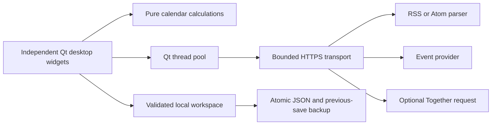

# Architecture

ShamsiCal 2 separates pure date logic, local persistence, transport, background jobs, and presentation. Version 2.1 keeps the original independent-desktop-widget product model while sharing the safer core services. There is no tabbed dashboard.

| Module | Responsibility |
| --- | --- |
| `calendar.py` | Jalali month length, clamped navigation, Saturday-first grid, digit formatting, safe Hijri range handling |
| `storage.py` | Schema validation, 16 MiB workspace limit, atomic replacement, previous-valid-save backup, corruption refusal |
| `network.py` | Public HTTPS validation, address pinning, response bounds, feed/event schemas, optional AI request |
| `jobs.py` | Bounded Qt thread pool and result delivery back on the GUI thread |
| `app.py` | Startup and single-writer workspace lock |
| `desktop.py` | Daily calendar, optional month widget, independent notes/RSS/quotes, tray, settings, and lifecycle |
| `floating.py` | Frameless tool windows, dragging, resizing, and independent geometry persistence |
| `notes.py`, `reader.py`, `settings.py` | Reusable content/settings controls hosted in separate windows |
| `widgets.py` | Reusable controls and a rich-text document that blocks external resources |
| `i18n.py`, `theme.py`, `icons.py` | UI copy, shared visual tokens, in-process Phosphor font loading |

## State and races

The main thread owns all widgets and workspace state. Workers return values through Qt signals; they do not mutate widgets or files. A feed-generation counter invalidates obsolete responses after selection or deletion. One event request runs at a time; completion checks the selected date before updating the visible result. Failed requests never become a successful empty cache entry.

Settings rebuild widget content after collecting the current note and saving, preserving each widget's layout and visibility. Rebuild actions wait for running jobs, avoiding callbacks into deleted controls. The process uses a `QLockFile` per data directory, preventing two instances from overwriting the same workspace. A 500 ms note-save debounce reduces writes; Quit performs a final save and stays open if it fails. Closing an auxiliary widget only hides that widget.

## Scope and tradeoffs

- A single versioned JSON workspace keeps backup and migration understandable. It is capped at 16 MiB and is not an encrypted notebook or a large document database.
- Each widget is an independent frameless Qt Tool window with no QWidget parent, so hiding the calendar does not hide the rest. Header dragging, resize grips, visible icon buttons, menus, and a tray provide desktop interaction. Compact mode affects the daily calendar only.
- No provider SDK is required. The optional AI request uses the same constrained HTTPS transport, and the model is explicitly configured rather than assuming an old free model still exists.
- No runtime dependency downloads, automatic updates, browser automation, HTML browser engine, or local web server are used.
- The runtime lock records all published artifact hashes for the selected versions. Python/OS packages and build tools still influence binary reproducibility; ZIPs are not claimed bit-for-bit reproducible across hosts.
