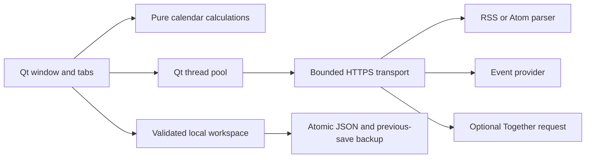

# Architecture

ShamsiCal 2 separates pure date logic, local persistence, transport, background jobs, and presentation. It replaces the three tightly coupled floating-widget modules from v1 with one conventional desktop window.

| Module | Responsibility |
| --- | --- |
| `calendar.py` | Jalali month length, clamped navigation, Saturday-first grid, digit formatting, safe Hijri range handling |
| `storage.py` | Schema validation, 16 MiB workspace limit, atomic replacement, previous-valid-save backup, corruption refusal |
| `network.py` | Public HTTPS validation, address pinning, response bounds, feed/event schemas, optional AI request |
| `jobs.py` | Bounded Qt thread pool and result delivery back on the GUI thread |
| `app.py` | Window composition, navigation, date rollover, debounced event lookup, lifecycle and single-writer lock |
| `notes.py`, `reader.py`, `settings.py` | Independent tabs with explicit user actions |
| `widgets.py` | Reusable controls and a rich-text document that blocks external resources |
| `i18n.py`, `theme.py`, `icons.py` | UI copy, shared visual tokens, in-process Phosphor font loading |

## State and races

The main thread owns all widgets and workspace state. Workers return values through Qt signals; they do not mutate widgets or files. A feed-generation counter invalidates obsolete responses after selection or deletion. One event request runs at a time; completion checks the selected date before updating the visible result. Failed requests never become a successful empty cache entry.

Settings rebuild the tabs after collecting the current note and saving. Rebuild actions wait for running jobs, avoiding callbacks into deleted controls. The process uses a `QLockFile` per data directory, preventing two instances from overwriting the same workspace. A 500 ms note-save debounce reduces writes; close performs a final save and stays open if it fails.

## Scope and tradeoffs

- A single versioned JSON workspace keeps backup and migration understandable. It is capped at 16 MiB and is not an encrypted notebook or a large document database.
- A conventional window supports the OS window controls and assistive technology. Compact mode replaces independent floating-widget layout customization.
- No provider SDK is required. The optional AI request uses the same constrained HTTPS transport, and the model is explicitly configured rather than assuming an old free model still exists.
- No runtime dependency downloads, automatic updates, browser automation, HTML browser engine, or local web server are used.
- The runtime lock records all published artifact hashes for the selected versions. Python/OS packages and build tools still influence binary reproducibility; ZIPs are not claimed bit-for-bit reproducible across hosts.
